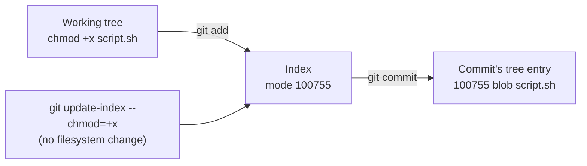

# Git Command Cheat Sheet

A task-ordered collection of useful [[concepts/version_control/git|Git]] commands, each with a one-line comment. The hub note explains *why* the commands behave as they do (the object model, the four areas, merge shapes, the reset modes). This note is the place to look up and add commands.

## Setup

```bash
git config --global user.name  "Ada Lovelace"      # identity recorded in every commit
git config --global user.email "ada@example.com"
git config --global init.defaultBranch main        # new repos start on main, not master
git config --global pull.rebase true               # pull rebases instead of merging
git config --list --show-origin                    # which file set which value

git init                    # create a repository in the current directory
git clone <url> [<dir>]     # copy an existing one, including all history
```

## Recording Changes

```bash
git status                   # what is modified, staged, and untracked
git status -sb               # the same, two lines shorter

git add <path>               # stage a file or directory
git add -p                   # stage selected hunks interactively
git add -A                   # stage everything, including deletions

git diff                     # working tree vs. index  — what is NOT staged
git diff --staged            # index vs. HEAD          — what IS staged
git diff HEAD                # working tree vs. HEAD   — everything uncommitted

git commit -m "<message>"    # commit the index
git commit -am "<message>"   # stage tracked modifications and commit (skips untracked files)

git rm <path>                # delete and stage the deletion
git rm --cached <path>       # stop tracking but keep the file on disk
git mv <old> <new>           # rename; Git detects renames by content anyway
```

## File Permissions

Git records only one permission bit per file: whether it is executable. The mode is stored in the tree entry, not in the blob.

| Mode | Meaning |
| --- | --- |
| `100644` | Regular file |
| `100755` | Executable file |
| `120000` | Symbolic link |
| `160000` | Submodule (gitlink) |
| `040000` | Directory (tree) |

```bash
git ls-files --stage                   # list staged files with their modes
git ls-files --stage script.sh         # one file: mode, blob hash, stage number, path
# 100755 3b18e512dba79e4c8300dd08aeb37f8e728b8dad 0	script.sh
#    ^^^ the last three digits are the permission: 644 normal, 755 executable

git update-index --chmod=+x <files>    # mark executable in the index (no chmod on disk needed)
git update-index --chmod=-x <files>    # remove the executable bit
git add --chmod=+x <files>             # the same, while staging the file
git commit -m "chore: make script executable"

git ls-tree HEAD script.sh             # the mode as committed
git diff                               # a mode-only change shows "old mode 100644 / new mode 100755"
git config core.fileMode false         # ignore executable-bit changes on disk (e.g. on Windows or FAT mounts)
```



`git update-index --chmod` is the way to set the bit on a system whose filesystem has no executable bit, such as Windows. It changes the index directly, and the next commit records the new mode. With `core.fileMode false`, Git also ignores permission changes made on disk.

## Inspecting History

```bash
git log --oneline --graph --decorate --all   # the one log invocation worth aliasing
git log -p <path>                            # patches touching a path
git log -S "<string>"                        # commits that added or removed a string ("pickaxe")
git log --since="2 weeks ago" --author=ada
git show <commit>                            # one commit's metadata and diff
git blame <file>                             # last commit to touch each line
git shortlog -sn                             # commit counts per author
git bisect start / bad / good                # binary search for the commit that broke something
git bisect run <script>                      # let a test script drive the bisect
git reflog                                   # everywhere HEAD has pointed, including "lost" commits
```

### Plumbing

```bash
git cat-file -p HEAD          # a commit's raw tree, parent, author, and message
git cat-file -p <hash>        # any object: blob contents, tree listing, tag
git ls-tree HEAD              # the root tree: modes, types, hashes, names
git rev-parse HEAD            # resolve a name to a full commit hash
git hash-object <file>        # the blob hash a file would get
```

## Branching and Merging

```bash
git branch                       # list local branches
git switch <branch>              # move HEAD to an existing branch
git switch -c <branch>           # create and move to a new one
git branch -d <branch>           # delete a merged branch (-D to force)
git merge <branch>               # merge into the current branch
git merge --no-ff <branch>       # force a merge commit even when fast-forward is possible
git merge --abort                # back out of a conflicted merge
```

## Rebasing and Rewriting History

```bash
git rebase <base>               # replay the current branch's commits on top of <base>
git rebase -i <base>            # interactively reorder, squash, edit, or drop them
git rebase --continue|--abort   # after resolving a conflict, or to give up
git commit --amend              # replace the most recent commit
git cherry-pick <commit>        # replay one commit onto the current branch
git revert <commit>             # a NEW commit that undoes an old one
```

Never rewrite commits that others have already pulled; see the golden rule in [[concepts/version_control/git#Rebasing and Rewriting History|Git]].

## Undoing Things

| Goal | Command | Touches |
| --- | --- | --- |
| Discard edits to a file | `git restore <path>` | Working tree |
| Unstage a file, keep the edits | `git restore --staged <path>` | Index |
| Fix the last commit's message or contents | `git commit --amend` | Last commit (new hash) |
| Undo the last commit, keep changes staged | `git reset --soft HEAD~1` | HEAD |
| Undo the last commit, keep changes unstaged | `git reset HEAD~1` (`--mixed`, default) | HEAD + index |
| Undo the last commit and destroy the changes | `git reset --hard HEAD~1` | HEAD + index + working tree |
| Undo a commit that is already pushed | `git revert <commit>` | Adds a new commit |
| Delete untracked files | `git clean -fd` (`-n` to preview first) | Working tree |
| Recover from a bad reset or rebase | `git reflog` then `git reset --hard <ref>` | HEAD + index + working tree |

### Stashing

```bash
git stash push -m "<label>"   # shelve working tree and index changes
git stash push -u             # include untracked files
git stash list
git stash pop                 # reapply the most recent and drop it
git stash apply stash@{2}     # reapply a specific one, keeping it in the list
```

## Working with Remotes

```bash
git remote -v                       # configured remotes
git remote add <name> <url>
git fetch <remote> [--prune]        # download objects, update origin/*, touch nothing local
git log HEAD..origin/main           # what fetching brought in, before integrating
git pull                            # fetch + integrate into the current branch
git pull --rebase                   # fetch + rebase instead of merge
git push <remote> <branch>
git push -u origin <branch>         # push and set the upstream tracking branch
git push --force-with-lease         # overwrite a remote branch, but only if it is where you last saw it
```

## Tags and Releases

```bash
git tag                               # list
git tag -a v1.4.0 -m "Release 1.4.0"  # annotated: its own object, author, date, message
git tag v1.4.0                        # lightweight: just a ref, no metadata
git tag -s v1.4.0 -m "..."            # annotated and GPG-signed
git push origin v1.4.0                # tags are NOT pushed by default
git push --follow-tags                # push commits plus the annotated tags reachable from them
git describe --tags                   # human-readable name for the current commit: v1.4.0-12-gabc1234
```

## Large or Long-Lived Repositories

| Need | Command |
| --- | --- |
| Several branches checked out at once, no re-cloning | `git worktree add ../feature-x feature-x` |
| Clone without full history | `git clone --depth 1 <url>` |
| Clone without file contents until needed | `git clone --filter=blob:none <url>` (partial clone) |
| Check out part of a large tree | `git sparse-checkout set <dir>...` |
| Keep a big repository fast | `git maintenance start`, `git gc` |
| Embed another repository at a pinned commit | `git submodule add <url> <path>` |

## Related Concepts

- [[concepts/version_control/git|Git]] — the object model, the four areas, and the explanations behind every command listed here
- [[concepts/version_control/conventional_commits|Conventional Commits]] — the message format for the `git commit -m` lines above
- [[concepts/version_control/gitlab/gitlab_repository_security|GitLab Repository Security]] — server-side rules that can reject a `git push --force` or a tag deletion

## References

- [Git reference manual](https://git-scm.com/docs) — per-command documentation
- [git-update-index](https://git-scm.com/docs/git-update-index) — including `--chmod`
- [git-ls-files](https://git-scm.com/docs/git-ls-files) — including `--stage`
